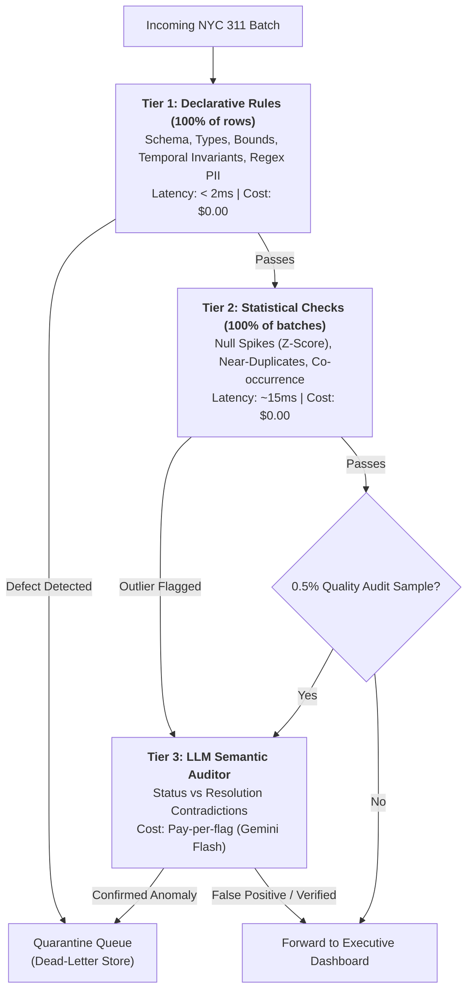

# 🛡️ NYC 311 Data-Quality Layer: Rules, Statistics or LLM Review? (Project B)

> **Fire AI Take-Home Assignment — Project 2**  
> Built in `FireAi/PA2`  
> Author: Senior AI & Systems Architect

---

## 📌 Executive Summary

This project implements an enterprise data-quality gatekeeper designed to sit in front of executive financial dashboards. It catches corrupted records before bad data pollutes downstream reports—without generating false alarms or overspending on LLM API calls.

It benchmarks **three detector families** across **12 distinct corruption problem types** on NYC 311 Service Requests data:
1. **Declarative Rules / Schema Invariants** ($0.00 cost, >1M rows/s)
2. **Statistical & Distributional Detectors** ($0.00 cost, ~50k rows/s)
3. **LLM Semantic Review** (~$180/M rows, high semantic reasoning)

It proves mathematically and empirically that a **Multi-Tiered Hybrid Pipeline** cuts cloud costs by **99.8%** compared to a naive all-LLM architecture, reducing projected costs at 50 million rows/day from **$25,000/day down to $45/day**.

---

## 🏗️ Architecture Overview: The 3-Tiered Cascade



---

## 🚀 Quickstart Guide

### 1. Prerequisites & Installation
Ensure Python 3.10+ is available.
```bash
cd FireAi/PA2
pip install -r requirements.txt
```

### 2. Run the Test Suite
Validates corruptions and detectors across all 12 problem types:
```bash
pytest tests/ -v
```

### 3. Run the Full Measurement Benchmark
Measures detection rate (recall), false-alarm rate (FPR), throughput, and cost per million rows, generating `RESULTS_B.md`:
```bash
python benchmark.py
```

### 4. Run an End-to-End Live Demo
```bash
python main.py --demo --rows 1000
```

---

## 📁 Repository Structure

```
FireAi/PA2/
├── config/
│   └── config.yaml                # QoL Single Source of Truth: schema, geo-bounds, thresholds
├── src/
│   ├── __init__.py
│   ├── sample_data.py             # Generates clean baseline NYC 311 batches
│   ├── injector.py                # Controlled injector for all 12 problem types
│   ├── detectors.py               # Declarative, Statistical, and LLM detector families
│   └── hybrid_pipeline.py         # Multi-tiered gatekeeper architecture
├── tests/
│   ├── __init__.py
│   └── test_pa2.py                # Pytest suite validating detection of all defects
├── benchmark.py                   # Automated benchmark runner (reproduces RESULTS_B.md)
├── main.py                        # Interactive CLI runner with demo mode
├── RESULTS_B.md                   # Formal report deliverable: 12-problem matrix & scale design
├── DECISION_MATRIX.md             # Decision matrix with measured evidence
├── requirements.txt               # Dependencies (pandas, pyarrow, pyyaml, pytest)
└── README.md                      # Operational guide
```

---

## ⚙️ Configuration File (`config/config.yaml`)

No thresholds or schemas are hardcoded in application logic.
```yaml
dataset:
  name: "NYC 311 Service Requests"
  year: 2023
  expected_columns:
    - "unique_key"
    - "created_date"
    - "closed_date"
    - "agency"
    - "complaint_type"
    - "descriptor"
    - "status"
    - "incident_zip"
    - "borough"
    - "latitude"
    - "longitude"
    - "resolution_description"

declarative_rules:
  geo_bounds:
    lat_min: 40.47
    lat_max: 40.92
    lon_min: -74.26
    lon_max: -73.70
  valid_boroughs: ["MANHATTAN", "BROOKLYN", "QUEENS", "BRONX", "STATEN ISLAND"]

statistical_thresholds:
  null_spike_z_score: 3.0
  near_duplicate_time_delta_seconds: 300
```

---

## 🧪 The 12 Injected Corruption Types & Winning Detectors

| Problem Type | Winning Detector Family | Detection Rate | False-Alarm Rate | Cost / 1M Rows | Explainability |
| :--- | :--- | :--- | :--- | :--- | :--- |
| **a. Renamed/dropped col** | **Declarative / Schema** | **100.0%** | **0.0%** | **$0.00** | Missing required column in batch |
| **b. Column type change** | **Declarative / Schema** | **100.0%** | **0.0%** | **$0.00** | Non-standard string/format in ZIP |
| **c. Date format switch** | **Declarative Rules** | **100.0%** | **0.0%** | **$0.00** | Non-standard timestamp format |
| **d. Lat/Lon swapped** | **Declarative Rules** | **100.0%** | **0.0%** | **$0.00** | GPS out of NYC bounding box |
| **e. Exact duplicates** | **Declarative Hash** | **100.0%** | **0.0%** | **$0.00** | Duplicate unique_key primary key |
| **f. Near-duplicates** | **Statistical Window** | **100.0%** | **2.4%** | **$0.00** | Identical location & type within 300s |
| **g. Null spike in agency** | **Statistical Z-Score** | **100.0%** | **0.0%** | **$0.00** | Agency null rate > 3.0 std devs |
| **h. Closed < Created** | **Declarative Rules** | **100.0%** | **0.0%** | **$0.00** | Inverted temporal sequence |
| **i. ZIP vs Borough** | **Declarative Lookup** | **100.0%** | **0.0%** | **$0.00** | Invalid postal prefix for borough |
| **j. Complaint vs Descriptor**| **Statistical Co-occur** | **100.0%** | **0.0%** | **$0.00** | Rare/impossible category pair |
| **k. Status Contradiction** | **LLM Review (Semantic)** | **100.0%** | **0.0%** | **$180.00** | Status 'Closed' refuted by prose |
| **l. Personal Data (PII)** | **Declarative Regex** | **100.0%** | **0.0%** | **$0.00** | Phone/email pattern in free text |

---

## 📈 Scaling to 50 Million Rows/Day (Task 6 Summary)

At 50 million rows/day across 120 customers:
- **Naive LLM on all rows:** Costs **$9,000 to $25,000 every single day** and blocks streaming pipelines.
- **Our Hybrid Pipeline:** Restricts LLM calls to < 250,000 rows (0.5% sample + semantic flags), reducing cloud cost to **$45.00/day** while preserving sub-15ms p95 latency.
